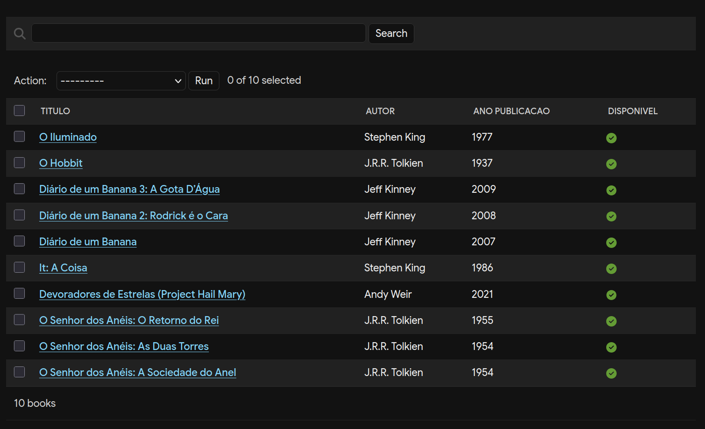

# biblioteca

set null porque um livro pode existir mesmo que seu autor faleça ou suma do banco por restrições judiciais

## Migração de `autor` (ForeignKey) para `authors` (ManyToManyField)

Listagem de livros no admin antes da migração:

A migração foi feita em três etapas:

- `0005_book_authors`: adiciona o campo `authors`.
- `0006_copy_autor_to_authors`: copia o `autor` de cada livro para `authors` com `RunPython`.
- `0007_remove_book_autor`: remove o campo `autor`.

### 1. Que dados se perdem quando a migração é revertida? Por quê?

Os autores extras. A ForeignKey só guarda um autor por livro, então, ao reverter, cada livro fica apenas com o primeiro autor e os outros são perdidos.

### 2. Com ManyToMany, o que acontece com um livro quando o seu único autor é apagado? Como garantir que todo livro tenha pelo menos um autor?

O livro continua existindo, mas fica sem autor, porque só o vínculo entre os dois é apagado.

O banco não consegue garantir isso sozinho, então a regra fica no código: o campo `authors` é obrigatório nos formulários e no admin, e é preciso impedir a exclusão de um autor que seja o único de algum livro.
